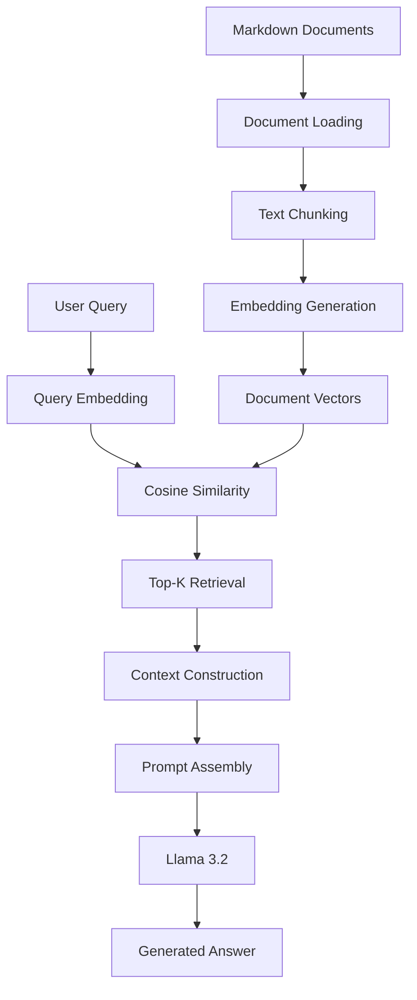

# RAG From Scratch

**An End-to-End Retrieval-Augmented Generation Pipeline Using Python, Ollama and NumPy**

A lightweight, locally running Retrieval-Augmented Generation (RAG) system built from scratch. The application retrieves relevant information from custom Markdown documents using semantic similarity and generates context-aware responses using a locally hosted Large Language Model (LLM).

The project focuses on understanding the core components of RAG without relying on high-level frameworks such as LangChain or LlamaIndex.

---

## Overview

Large Language Models have limitations when answering questions about private, domain-specific, or custom information that may not be included in their training data.

Retrieval-Augmented Generation addresses this limitation by retrieving relevant information from an external knowledge source and providing it to an LLM as contextual input.

This project implements a complete basic RAG workflow:

- Document loading and text chunking
- Embedding generation using Nomic Embed Text
- Vector representation using NumPy
- Semantic retrieval using cosine similarity
- Context construction and prompt engineering
- Answer generation using Llama 3.2

## Architecture



## Technology Stack

| Technology       | Role                                         |
| ---------------- | -------------------------------------------- |
| Python           | Application development                      |
| Ollama           | Local model execution and API                |
| Llama 3.2 (3B)   | Context-based response generation            |
| Nomic Embed Text | Text embedding generation                    |
| NumPy            | Vector operations and similarity computation |
| Requests         | HTTP communication with Ollama               |
| Pathlib          | Document loading and file handling           |

## Project Structure

```text
RAG-FROM-SCRATCH/
│
├── docs/
│   ├── python.md
│   ├── machine_learning.md
│   └── rag.md
│
├── main.py
├── pyproject.toml
├── uv.lock
└── README.md
```

| Component        | Description                                         |
| ---------------- | --------------------------------------------------- |
| `docs/`          | Contains Markdown files used as the knowledge base. |
| `main.py`        | Implements the RAG pipeline.                        |
| `pyproject.toml` | Defines project configuration and dependencies.     |
| `uv.lock`        | Records locked dependency versions.                 |

## Getting Started

### Prerequisites

Ensure the following are installed:

- Python 3.10+
- Ollama
- uv (recommended for Python dependency management)

### 1. Clone the Repository

```bash
git clone <repository-url>
cd RAG-FROM-SCRATCH
```

### 2. Install Dependencies

Using uv:

```bash
uv sync
```

Alternatively, install dependencies manually:

```bash
pip install requests numpy
```

### 3. Install Ollama Models

Download the embedding model:

```bash
ollama pull nomic-embed-text
```

Download the language model:

```bash
ollama pull llama3.2:3b
```

### 4. Start Ollama

Ollama exposes a local REST API at:

```text
http://localhost:11434
```

Ensure the Ollama service is running before executing the application.

Verify the installed models:

```bash
ollama list
```

### 5. Run the Application

Using uv:

```bash
uv run main.py
```

Alternatively:

```bash
python main.py
```

The application will load the Markdown documents, generate embeddings and initialize the retrieval pipeline.

You can then enter questions through the terminal.

To terminate the application:

```text
exit
```

## Implementation Details

### 1. Document Loading and Chunking

The application reads Markdown documents from the `docs/` directory using Python's `pathlib`.

Documents are split into smaller chunks based on paragraph boundaries.

```python
for file in Path("docs").glob("*.md"):
    chunks += [
        p.strip()
        for p in file.read_text(encoding="utf-8").split("\n\n")
        if p.strip()
    ]
```

**Objective:** Convert large documents into smaller text segments that can be independently embedded and retrieved.

### 2. Embedding Generation

The `nomic-embed-text` model converts text chunks into numerical vector representations.

Ollama's embedding API is used:

```text
POST /api/embed
```

Each chunk is represented as a vector in a high-dimensional space.

These vectors capture semantic information about the text and enable similarity-based retrieval.

### 3. Vectorization

The generated embeddings are stored in a NumPy array.

```python
chunk_vectors = embed(chunks)
```

This creates a numerical representation of the document collection that can be efficiently compared with incoming query embeddings.

### 4. Semantic Retrieval Using Cosine Similarity

When a user submits a question, the same embedding model converts the query into a vector.

Cosine similarity measures the semantic closeness between the query vector and document chunk vectors.

**Cosine Similarity Formula:**

[
\text{Similarity}(A,B)=
\frac{A\cdot B}{|A||B|}
]

Where:

- A represents a document embedding.
- B represents the query embedding.
- A · B represents the dot product.
- ||A|| and ||B|| represent vector magnitudes.

The similarity scores are sorted in descending order, and the top 3 matching chunks are retrieved.

### 5. Context Construction

The retrieved chunks are combined into a single context string.

This context provides the external knowledge required by the LLM to answer the user's question.

### 6. Response Generation

The retrieved context and user query are assembled into a prompt and sent to Llama 3.2 using Ollama's chat API.

```text
POST /api/chat
```

The prompt instructs the model to:

- Answer using only the retrieved context.
- Avoid relying on unrelated external knowledge.
- Respond with "I don't know" if the answer is unavailable in the provided context.

The generated response is displayed directly in the terminal.

## Example Interaction

```text
Ask: What is machine learning?

Context:
Machine learning is a branch of artificial intelligence
that enables systems to learn from data.

Machine learning algorithms identify patterns and
make predictions based on available information.

Answer:
Machine learning is a branch of artificial intelligence
that enables systems to learn from data, identify
patterns and make predictions.
```

*Illustrative output. Actual responses depend on the documents in the knowledge base and the LLM's generation.*

## Current Capabilities

- Local LLM inference using Ollama.
- Custom Markdown document ingestion.
- Paragraph-based text chunking.
- Embedding generation using Nomic Embed Text.
- Semantic search using cosine similarity.
- Top-K document retrieval.
- Context-based answer generation.
- Basic protection against answering questions outside the retrieved context.


## Learning Outcomes

This project explores the fundamental concepts behind Retrieval-Augmented Generation through a practical implementation.

Key concepts covered:

- RAG architecture and workflow
- Document ingestion and preprocessing
- Text embeddings and vector representations
- Cosine similarity and semantic search
- Top-K retrieval mechanisms
- Prompt construction and context injection
- Local LLM integration through REST APIs
- Building an end-to-end AI application without high-level RAG frameworks

##
